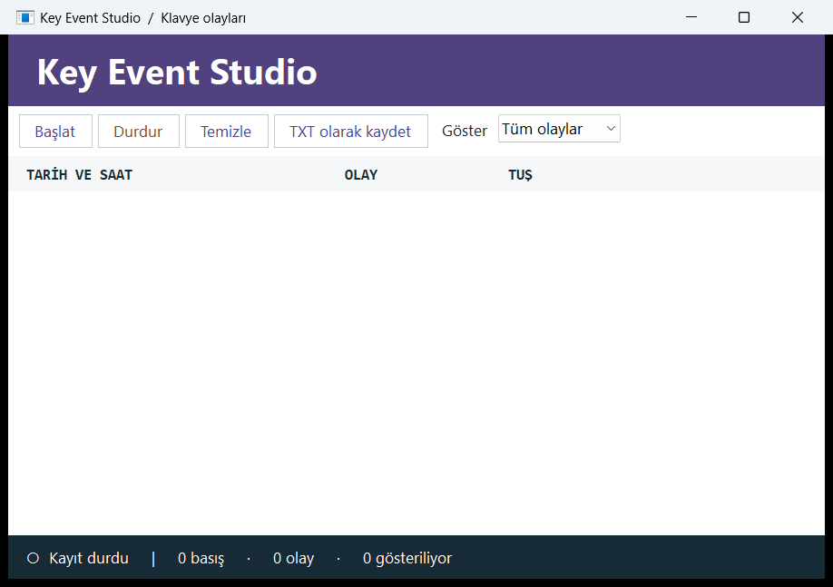
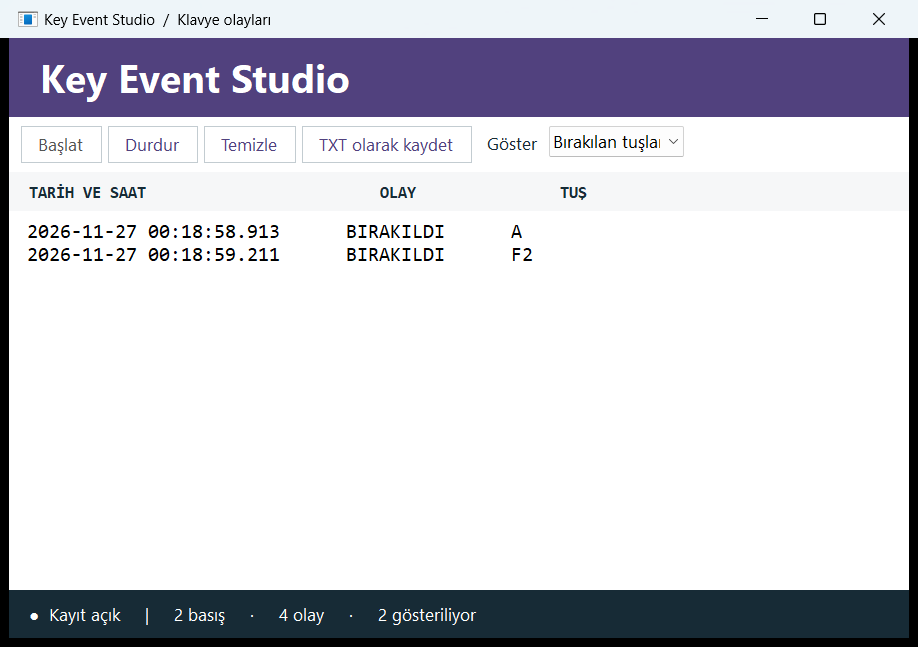

# Key Event Studio

Etkin uygulama penceresindeki klavye olaylarını zaman damgasıyla gösteren eğitim aracı.

**YMH219 Nesne Tabanlı Programlama** · Muhammed AHMED · 250541604

## Kullanılan teknolojiler

C#, .NET 10 ve Windows Forms. WinForms KeyPreview, KeyDown/KeyUp, ListBox, HashSet ve UTF-8 metin dosyaları. Haricî paket gerekmez.

## Kurulum ve çalıştırma

Windows 10/11 x64 üzerinde Git ve .NET 10 SDK gerekir. SDK kurulumunu `dotnet --list-sdks` ile kontrol edebilirsiniz. [Microsoft .NET 10 indirmeleri](https://dotnet.microsoft.com/download/dotnet/10.0)

```powershell
git clone https://github.com/MuhammedAHMED7/YMH219-KeyEventLogger.git
cd YMH219-KeyEventLogger
dotnet restore
dotnet build -c Release
dotnet run -c Release --no-build
```

Visual Studio'da .NET 10 destekli bir sürüm ve **.NET masaüstü geliştirme** iş yüküyle `KeyEventLogger.csproj` dosyasını açıp F5'e basabilirsiniz.

## Temel özellikler ve kullanım

1. **Başlat** düğmesine basın ve liste odaktayken birkaç tuşa basıp bırakın.
2. `BASILDI` ve `BIRAKILDI` satırlarının tarihini, milisaniyesini ve tuş adını karşılaştırın. Basış sayacı yalnız ilk `KeyDown` olayında artar.
3. **Durdur** ile kaydı kapatın. **TXT olarak kaydet** ile hedefi seçin. **Temizle** listedeki kayıtları kaldırır.

Göster listesinden basışları, bırakmaları veya tüm olayları seçebilirsiniz. Alt çubuk toplam ve görünen olay sayılarını ayrı gösterir. TXT çıktısı filtre seçimine bakılmaksızın tüm oturumu içerir.

## Sınıflar ve sorumluluklar

`KeyJournal` basılı tuş kümesini, olay listesini, sayacı ve dışa aktarmayı yönetir. `MainForm` odağın kaybında basılı tuş kümesini sıfırlar. Başka bir pencerede bırakılan tuş için bir bırakma olayı üretilmez.

## Ekran görüntüleri





## Test ve bilinen sınırlamalar

Aynı tuşa iki Down ve bir Up iletildiğinde bir basış ve iki olay oluştu. Başka penceredeki giriş ve durdurma sonrası giriş sayacı artırmadı. İki basıştan oluşan dört satır TXT dosyasından geri okunarak içerik ve sıra karşılaştırıldı. Uygulama yalnız kendi etkin formunda çalışır.
